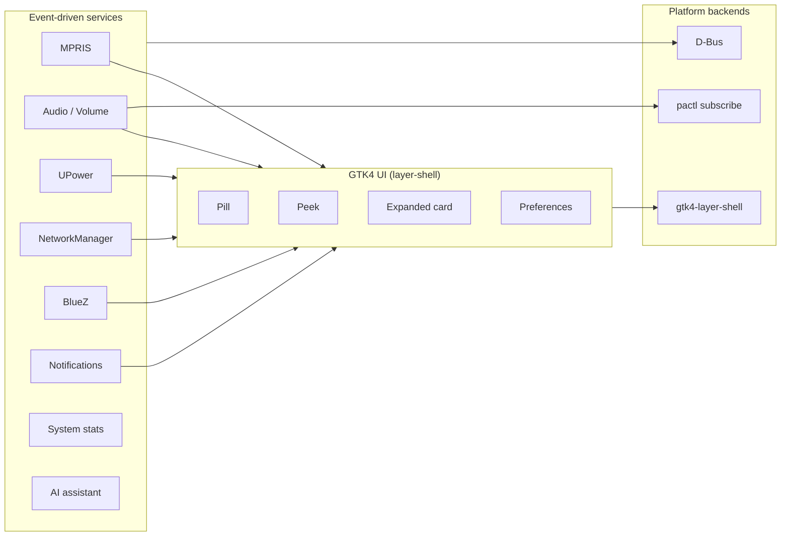

<h1 align="center">LedgePill</h1>

<p align="center">
  <b>The iPhone's Dynamic Island — rebuilt natively for every screen you own.</b><br>
  A little black island lives at the top of your screen. It breathes with your music,<br>
  peeks when something happens, and blooms into a full card when you ask.<br>
  <i>Fluid. Native. Light on your battery.</i>
</p>

<p align="center">
  Linux &nbsp;·&nbsp; Windows &nbsp;·&nbsp; macOS &nbsp;·&nbsp; Android &nbsp;&nbsp;|&nbsp;&nbsp; v1.0.0 &nbsp;·&nbsp; MIT
</p>

<p align="center">
  <b><a href="https://mariakevin.github.io/LedgePill/">▶ Play with the interactive demo in your browser</a></b>
</p>

---

## Quick start

Linux, one line:

```bash
curl -fsSL https://raw.githubusercontent.com/Mariakevin/LedgePill/main/packaging/install.sh | sudo bash
ledge-pill                                        # run it
systemctl --user enable --now ledge-pill.service  # keep it
```

Package-manager installs for Arch, Debian/Ubuntu and Fedora, plus the Windows,
macOS and Android builds, are in [Install](#install) and
[Windows, macOS, Android](#windows-macos-android).

---

## Contents

| Get started | Go deeper |
|---|---|
| [What is LedgePill?](#what-is-ledgepill) | [Light on your battery](#light-on-your-battery--by-architecture) |
| [Feature tour](#feature-tour) | [Architecture](#architecture) |
| [Install](#install) | [Configuration](#configuration) |
| [Windows, macOS, Android](#windows-macos-android) | [CLI](#cli) |
| [FAQ](#faq) | [Hacking](#hacking) |
| [License](#license) | [Design system](#design-system) |

---

## What is LedgePill?

LedgePill is a **native, cross-platform Dynamic Island** — the small, animated pill that lives at the top of your screen and reacts to everything: music, volume, battery, notifications, network, Bluetooth, weather, your Pomodoro timer, even your AI assistant.

It is **one open-source project** with the same design language on every platform, built with **zero web runtimes** — GTK4 on Linux, WPF on Windows, AppKit on macOS, Kotlin on Android. No Electron. No web views. Just native widgets and a shared aesthetic.

> Most of the time it's a quiet pill with the clock. Play some music and it picks up the track. Touch your volume keys and it becomes an OSD. Plug in the charger, connect your earbuds, switch Wi-Fi, or get a notification and it **peeks** to tell you — then melts back into a pill. Click it and it **blooms** into a full card.

### At a glance

| | |
|---|---|
| **What it is** | A Dynamic Island for your desktop — pill, peeks and a full card |
| **Platforms** | Linux (flagship) · Windows · macOS · Android (beta) |
| **Built with** | GTK4 · WPF (.NET 8) · AppKit (Swift) · Kotlin — no Electron, no web views |
| **Footprint** | ≈ 0.2 % idle CPU, ≈ 110 MB PSS on KDE Plasma / Wayland |
| **Install** | Arch, Debian/Ubuntu, Fedora, or one script |
| **License** | MIT |

---

## Feature tour

### 🎵 Media
- **Every MPRIS player** (Spotify, Firefox, mpv, Elisa, …): album art, title/artist/album, seek bar, prev/play/next.
- The island **elects the active player**, so a paused podcast never hides the song you started.
- With [cava](https://github.com/karlstav/cava) installed, the five EQ bars follow the **actual audio spectrum**, beat by beat — and the cava process only exists while music plays and the bars are on screen.
- **Synced lyrics** fetched once per song from lrclib.net, riding along in the pill.

### 🧩 Pill faces — a deck you flip through
The collapsed island is a **deck of faces** cycled by click or horizontal swipe:
`auto` · `status` · `lyrics` · `title` · `compact` · `clock` · `battery` · `weather` · `bluetooth` · `ollama` · `mascot`.

Pick which faces are in the cycle from Settings. Right-click opens the full card; click empty card space (or drift away) to close it.

### 🐾 Mascot eyes
A clock face with **cursor-tracking animated eyes** — normal, sleepy, working (AI busy), or attention. The eyes follow your pointer across the whole screen via a global cursor watcher.

### 💧 Fluid morphs
One surface that interpolates between pill, peek and card, with hover growth — exactly like the one on the phone.

### 🔊 Volume & brightness OSD
The pill widens into a level bar the moment you touch your volume or brightness keys. Expanded card shows current volume, mic mute state, and display brightness.

### 🔋 Battery
Charge ring in the expanded card; peeks on plug/unplug.

### 🌐 Network & Bluetooth
- Connectivity chip + peeks on Wi-Fi/Ethernet changes.
- Connected Bluetooth device chip with **battery level**, peeks on connect/disconnect.

### 🌤 Weather
Current conditions in the card, fetched only when you open it (and at most every 30 minutes).

### 🔔 Notifications
- Mirrored **passively** from the session bus — your normal notification daemon keeps working untouched.
- Suppress peeks with **Do Not Disturb**; filter named applications.
- Up to 50 notifications persisted locally with **owner-only file permissions**; *Clear* removes them.

### 📡 Webhook messages
Authenticated local scripts send a short message to the island through a **loopback-only HTTP endpoint**. Bearer token stored with owner-only permissions in `$XDG_DATA_HOME/ledge-pill/webhook-token`.

### 📰 Information feeds
Optional **RSS/Atom and JSON endpoints** appear in the expanded card. Configure sources in `~/.config/ledge-pill/config.json`; they refresh every five minutes while the card is open.

### 🔇 Mute indicators
Reads system volume and microphone mute state for on-screen indicators.

### ⚡ Quick toggles
- **Caffeine** — blocks sleep via `systemd-inhibit`.
- **Screenshot** shortcut.

### 📊 System stats
CPU and RAM readout, sampled **only while the card is open**.

### 🤖 AI assistant
Local **Ollama** or **LM Studio**, with optional **Claude, Gemini, OpenRouter**. Local providers use native function calling for device controls; Ollama and LM Studio are discovered independently. System context and device controls are **disabled by default**; enabling them can share live device context with the selected remote provider. The assistant exposes only currently available LedgePill actions; shutdown, reboot, suspend, lock, and ending an app still require confirmation.

### 👨‍💻 Developer activity
Reports detected **Claude Code, Codex, Aider, OpenCode, and Goose** processes, along with builds and package installs. Detection is limited to processes owned by the current user and shows tool names **without retaining or displaying prompts or command text**.

### 🍅 Pomodoro & tasks
- A 25-minute focus timer; while it runs, the countdown rides along in the pill. Optional automatic cycles add 5-minute breaks and a 15-minute break after every fourth focus round.
- Create and complete tasks in the expanded card; the task list persists between launches.

### ⚙️ Settings
Every option lives in a **native preferences window** (the gear in the card, or `ledge-pill --settings`) and applies instantly.

---

## Design system

LedgePill ships a small but deliberate visual language:

| Token | Values |
|---|---|
| **Themes** | `obsidian` · `liquid-glass` · `frosted` · `midnight` · `amber` |
| **Styles** | `pill` · `dashboard` · `vertical` · `waterdrop` · `notch` |
| **Animations** | `fluid` · `snappy` · `gentle` |
| **Accent modes** | `manual` · `auto` · `system` · `artwork` |
| **Fullscreen behavior** | `ignore` · `hide` · `compact` |

Accent color can be fixed, derived from the playing artwork, or pulled from the system. Fullscreen windows can be ignored, hidden-behind, or compacted automatically.

---

## Light on your battery — by architecture

Most service updates are **event-driven over DBus**. Desktop activity and privacy indicators use short, bounded checks; CPU and RAM sampling starts only while the expanded card is open:

| While | What runs |
|---|---|
| **Idle** | One wake per minute, aligned to the minute, to redraw the clock |
| **Music playing** | EQ bars animate; seek bar ticks at 1 Hz only while the card is open |
| **Volume changed** | Events from a sleeping `pactl subscribe` pipe |
| **Anything else** | Battery, network, media and notifications are pure DBus signals |
| **Their modules on** | Desktop state every 3 s, privacy indicators every 4 s |
| **Clicks outside** | Nothing — the layer surface hugs the island, so the compositor never wakes the app |

Measured on the machine it was built on (Arch, KDE Plasma / Wayland):
**≈ 0.2 % CPU when idle** and **≈ 110 MB PSS** (most of it shared GTK pages).

---

## Architecture



Single instance. Layer surface anchors to the top edge and hugs the island exactly, so input outside it never wakes the process.

---

## Install

| Platform | How |
|---|---|
| **Arch Linux** | `cd packaging && makepkg -si` |
| **Debian 12+ / Ubuntu 24.04+** | `.deb` from [Releases](https://github.com/Mariakevin/LedgePill/releases) |
| **Fedora** | `.rpm` from [Releases](https://github.com/Mariakevin/LedgePill/releases) |
| **Any distro** | `packaging/install.sh` |
| **Windows / macOS / Android** | See [below](#windows-macos-android) |

### Arch Linux

```bash
git clone https://github.com/Mariakevin/LedgePill
cd LedgePill/packaging && makepkg -si
```

### Debian 12+ / Ubuntu 24.04+

Grab the `.deb` from [Releases](https://github.com/Mariakevin/LedgePill/releases), or:

```bash
sudo apt install ./ledge-pill_*.deb
```

APT installs package dependencies automatically. Python 3.11+ required.
`libgtk4-layer-shell0` is optional and not available in every Ubuntu release;
without it, the app uses a floating window instead of a compositor layer surface.

### Fedora

```bash
sudo dnf install ledge-pill-*.rpm   # from Releases
```

### Any distro

```bash
curl -fsSL https://raw.githubusercontent.com/Mariakevin/LedgePill/main/packaging/install.sh | sudo bash
```

### Start it

```bash
ledge-pill                                        # try it
systemctl --user enable --now ledge-pill.service  # keep it
```

Works natively on Wayland compositors that speak layer-shell:
**KDE Plasma, Hyprland, Sway, river, Wayfire** and friends.
On GNOME Wayland (no layer-shell for apps) it falls back to a plain floating window.

---

## Windows, macOS, Android

Native companion apps live in this repo — same island, same design language,
built per-platform with **zero web runtimes**. They cover the core feature set
(clock + media) and are **beta**: CI-built, less battle-tested than the
Linux flagship.

| Platform | Stack | Media source | Get it |
|---|---|---|---|
| Windows 10/11 (x64) | WPF (.NET 8) | system media session (SMTC) | `LedgePill.exe` from [Releases](https://github.com/Mariakevin/LedgePill/releases) |
| macOS 13+ | AppKit (Swift) | Spotify / Apple Music | `LedgePill-macos.zip` from [Releases](https://github.com/Mariakevin/LedgePill/releases) |
| Android 8+ | Kotlin | any media session | `app-release.apk` from [Releases](https://github.com/Mariakevin/LedgePill/releases) |

The Android app hugs the display cutout like the real thing, cycles pill
faces on tap/swipe (lyrics included), and has its own settings screen.
Sideload notes: the APK is self-signed, so Play Protect shows an "unknown
developer" prompt — choose *Install anyway*. On Android 13+ the
notification-access toggle is locked for sideloaded apps until you open
*App info → ⋮ → Allow restricted settings*; the app walks you through it.

Build notes for each live in [`windows/`](windows/), [`macos/`](macos/) and
[`android/`](android/).

Windows and macOS release binaries are currently unsigned. Windows may show
a SmartScreen warning; macOS requires the first-launch confirmation described
in its build notes. Download binaries only from the project's official
Releases page.

---

## Configuration

Everything is editable from the settings window; the JSON at
`~/.config/ledge-pill/config.json` is the backing store:

| Key | Default | Meaning |
|---|---|---|
| `margin_top` | `0` | px between screen edge and island |
| `overlap_panel` | `true` | sit on top of bars/panels instead of below them |
| `monitor` | `""` | connector name (`DP-1`, `HDMI-A-1`); empty = primary |
| `layer` | `"top"` | `"overlay"` to float above fullscreen apps too |
| `idle_clock` | `true` | show the clock in the idle pill |
| `pill_face` | `"auto"` | current face (cycled by click / swipe) |
| `pill_faces` | `["auto", "status", "lyrics", "title", "clock"]` | faces in the cycle: `auto`, `status`, `lyrics`, `title`, `compact`, `clock`, `battery`, `weather`, `bluetooth`, `ollama`, `mascot` |
| `click_action` | `"wake"` | left click: `wake` (mascot/AI wobble, click again to expand), `expand`, or `cycle` |
| `opacity` | `0.97` | island background opacity, 0.3 – 1.0 |
| `clock_24h` | `true` | 24-hour clock |
| `pill_battery` | `true` | battery in the pill while charging or below 30% |
| `peek_seconds` | `2.2` | how long peeks stay up |
| `modules` | all on | toggleable modules: `assistant`, `battery`, `bluetooth`, `brightness`, `clipboard`, `desktop`, `feeds`, `kdeconnect`, `launcher`, `lyrics`, `music`, `network`, `notifications`, `ollama`, `privacy`, `system`, `toggles`, `volume_osd`, `weather` |
| `weather_city` | `""` | wttr.in place name; empty = automatic |
| `feeds` | `[]` | RSS/Atom or JSON feed objects (`name`, `type`, `url`) |
| `do_not_disturb` | `false` | keep notifications in history without showing peeks |
| `notification_blocklist` | `[]` | notification application names to ignore |
| `webhook_port` | `17334` | loopback port for authenticated local notification scripts |
| `ai_provider` | `"ollama"` | AI assistant backend: local Ollama/LM Studio or a remote API |
| `ai_model` | `""` | Optional model name override; otherwise the first available local model is used |
| `ai_system_control` | `false` | opt in to sharing live device context and enabling assistant controls |
| `ai_api_key` | `""` | API key for a selected remote AI provider |
| `accent` | `"#ff9f0a"` | accent color |

Local model servers default to Ollama on `127.0.0.1:11434` and LM Studio on
`127.0.0.1:1234`. Set `OLLAMA_HOST` or `LMSTUDIO_HOST` to use another local
address. The assistant exposes only currently available LedgePill actions;
shutdown, reboot, suspend, lock, and ending an app still require confirmation.

### Feeds

Example feed configuration:

```json
{
  "feeds": [
    {"name": "Project news", "type": "rss", "url": "https://example.org/feed.xml"},
    {"name": "Status", "type": "json", "url": "https://example.org/status.json"}
  ]
}
```

RSS/Atom sources use their entry title, summary/description and link. JSON
sources may return an array or an object containing an `items`, `entries`,
`results` or `data` array; each entry should have `title` (or `name`/`text`)
and may include `summary`/`description` and `url`/`link`.

### Webhooks

Send a local webhook notification with the private token generated on first
launch:

```bash
DATA_HOME="${XDG_DATA_HOME:-$HOME/.local/share}"
TOKEN="$(cat "$DATA_HOME/ledge-pill/webhook-token")"
curl --fail --silent -H "Authorization: Bearer $TOKEN" -H "Content-Type: application/json" \
  -d '{"app":"Build","title":"Build finished","body":"All checks passed."}' \
  http://127.0.0.1:17334/notify
```

---

## CLI

```
ledge-pill             start (single instance)
ledge-pill --toggle    expand / collapse a running island
ledge-pill --settings  open the settings window
ledge-pill --quit      stop it
```

---

## Hacking

```bash
git clone https://github.com/Mariakevin/LedgePill && cd LedgePill
python -m ledgepill                  # run from the tree
python scripts/demo-player.py        # fake MPRIS player to exercise the UI
python -m unittest discover tests    # tests
```

The screenshots in `docs/` are generated, not hand-cropped — real widgets, real
CSS, rendered headless: `scripts/render-shots.py`. The demo GIF is recorded
the same way (`scripts/record-demo.py`), and the browser demo lives in
`docs/index.html`, published at <https://mariakevin.github.io/LedgePill/>.

---

## FAQ

### Can I get the iPhone Dynamic Island on Android?

Yes — that's the Android app in this repo: a floating island pill that hugs
the punch-hole camera, shows your music with animated EQ bars and synced
lyrics, mirrors notifications, and expands into a media card. It works on
any Android 8+ phone; no root, no launcher change. Grab the APK from
[Releases](https://github.com/Mariakevin/LedgePill/releases).

### Is there a Dynamic Island for Linux?

That's the flagship here: a native GTK4 + layer-shell island for KDE
Plasma, Hyprland, Sway and any wlr compositor — Apple-style pill morphs,
MPRIS media controls, volume OSD, notification peeks, all measured at
~0.2 % idle CPU. Arch, Debian/Ubuntu and Fedora packages are in
[Releases](https://github.com/Mariakevin/LedgePill/releases).

### Does it work on Windows 11 or macOS?

Yes — native companions (WPF on Windows, AppKit on macOS) with the same
look: clock pill, now-playing with album art, media controls. Both are
prebuilt on every release.

### How is this different from the notch / punch hole "island" apps?

LedgePill is one open-source project with the same design language on
every platform, it's fully native (no Electron, no web views), and the
Linux version uses DBus notifications for most system events, with small
periodic checks for desktop activity and privacy indicators. CPU and RAM
sampling runs only while the expanded card is open.

---

## License

[MIT](LICENSE) © Marco Zorn

---

<p align="center">
  <b>If LedgePill lives on your screen, <a href="https://github.com/Mariakevin/LedgePill">leave it a ⭐</a> — it's how other people find it.</b>
</p>

<p align="center">
  <a href="#top">Back to top</a> &nbsp;·&nbsp;
  <a href="https://github.com/Mariakevin/LedgePill/releases">Releases</a> &nbsp;·&nbsp;
  <a href="https://github.com/Mariakevin/LedgePill/issues">Issues</a> &nbsp;·&nbsp;
  <a href="https://github.com/Mariakevin/LedgePill">GitHub</a>
</p>
