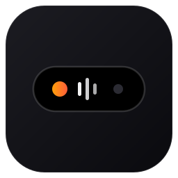
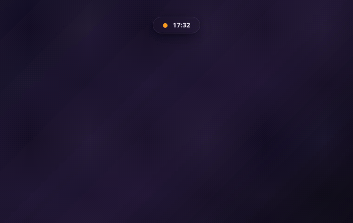
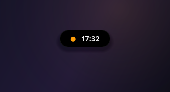
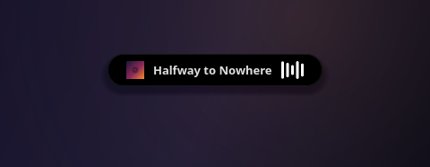
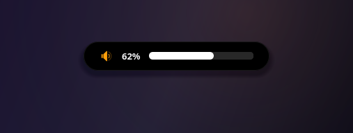
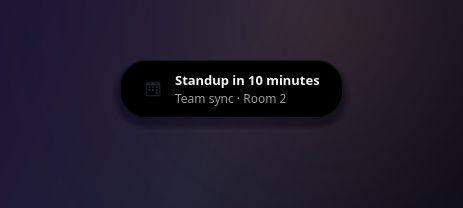
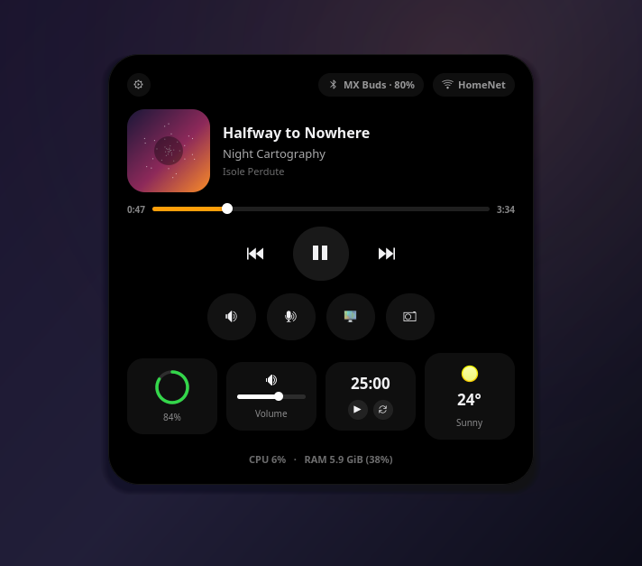
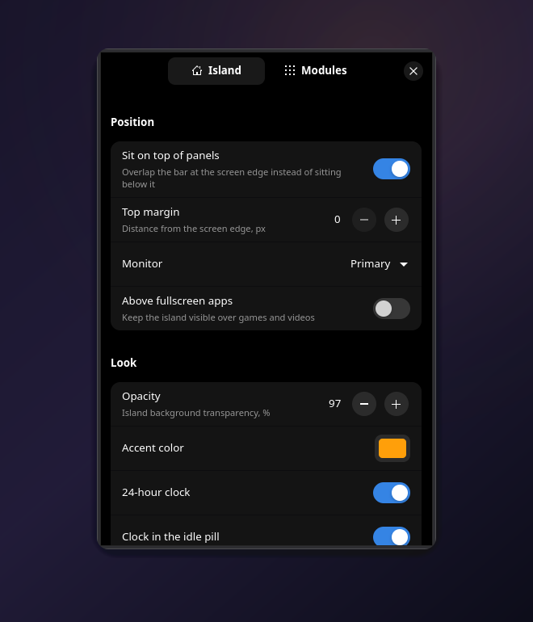

<p align="center">
  
</p>

<h1 align="center">Lost Island</h1>

<p align="center">
  <b>A Dynamic Island for your desktop — Linux, Windows, macOS and Android.</b><br>
  The iPhone's Dynamic Island, rebuilt natively for every screen you own.<br>
  Fluid, native, and light on your battery.
</p>

<p align="center">
  <a href="https://github.com/Mariakevin/lost-island-next/actions/workflows/build.yml"></a>
  
  
  
  <a href="https://github.com/Mariakevin/lost-island-next/stargazers"></a>
</p>

<p align="center">
  
</p>

<p align="center">
  <b><a href="https://marcozorn.github.io/lost-island/">▶ Play with the interactive demo in your browser</a></b>
</p>

A little black island lives at the top of your screen — on your bar, not
under it. Most of the time it's a quiet pill with the clock. Play some music
and it picks up the track; change the volume and it becomes an OSD; plug in
the charger, connect your earbuds, switch Wi-Fi, or get a notification and it
peeks to tell you — then melts back into a pill. Click it and it blooms into
a full card: album art, seek bar, media controls, quick toggles, battery
ring, volume, weather, a pomodoro timer, and live system stats.

| | |
|:---:|:---:|
|  |  |
| *idle — just the time* | *now playing, with live EQ* |
|  |  |
| *volume OSD peek* | *notification peek* |
|  |  |
| *the full card* | *native settings* |

## Features

- **Music** — every MPRIS player (Spotify, Firefox, mpv, Elisa, …): album
  art, title/artist/album, seek bar, prev/play/next. The island elects the
  *active* player, so a paused podcast never hides the song you started.
  With [cava](https://github.com/karlstav/cava) installed, the five EQ bars
  follow the actual audio spectrum, beat by beat — and the cava process only
  exists while music is playing and the bars are on screen.
- **Pill faces** — the collapsed island is a deck of faces you flip
  through with a click or a horizontal swipe: automatic (music/clock),
  clock + battery, **live synced lyrics**, song title (never the artist),
  album art + EQ, clock only, battery only, weather, and bluetooth. Pick
  which faces are in the cycle from Settings. Right-click opens the full card;
  click empty card space (or drift away) to close it.
- **Lyrics** — the lyrics face shows the current line, synced to playback,
  fetched once per song from lrclib.net.
- **Volume OSD** — the pill widens into a level bar the moment you touch
  your volume keys.
- **Audio status** — the expanded card shows current volume and microphone
  mute state. Use your keyboard controls to change them.
- **Brightness status** — the expanded card and OSD show the current display
  brightness. Use your keyboard controls to change it.
- **Battery** — charge ring in the expanded card, peeks on plug/unplug.
- **Notifications** — mirrored passively from the session bus; your normal
  notification daemon keeps working untouched. The app can suppress peeks
  with Do Not Disturb and filter named applications. Up to 50 notifications
  are persisted locally with owner-only file permissions; Clear removes them.
- **Webhook messages** — authenticated local scripts can send a short message
  to the island through a loopback-only HTTP endpoint. Its bearer token is
  stored with owner-only permissions in
  `$XDG_DATA_HOME/lost-island/webhook-token` (defaulting to
  `~/.local/share/lost-island/webhook-token`).
- **Network** — connectivity chip and peeks on Wi-Fi/Ethernet changes.
- **Bluetooth** — connected device chip with battery level, peeks on
  connect/disconnect.
- **Weather** — current conditions in the card, fetched only when you open
  it (and at most every 30 minutes).
- **Information feeds** — optional RSS/Atom and JSON endpoints appear in the
  expanded card. Configure sources in `~/.config/lost-island/config.json`; they
  refresh every five minutes while the card is open.
- **Mute indicators** — the app reads system volume and microphone mute state
  for its on-screen indicators. The desktop audio system and kernel handle the
  physical mute LEDs.
- **Quick toggles** — caffeine (blocks sleep via `systemd-inhibit`) and a
  screenshot shortcut.
- **System stats** — CPU and RAM readout, sampled only while the card is
  open.
- **AI assistant** — local Ollama or LM Studio, with optional Claude, Gemini
  and OpenRouter providers. Local providers use native function calling for
  device controls; Ollama and LM Studio are discovered independently. System
  context and device controls are disabled by default; enabling them can share
  live device context with the selected remote provider.
- **Developer activity** — the Linux pill reports detected Claude Code,
  Codex, Aider, OpenCode, and Goose processes, along with builds and package
  installs. Detection is limited to processes owned by the current user and
  shows tool names without retaining or displaying prompts or command text.
- **Pomodoro** — a 25-minute focus timer; while it runs, the countdown rides
  along in the pill. Optional automatic cycles add five-minute breaks and a
  fifteen-minute break after every fourth focus round.
- **Tasks** — create and complete tasks in the expanded card; the task list
  persists between launches in the user's data directory.
- **Fluid morphs** — one surface that interpolates between pill, peek and
  card, with hover growth, exactly like the one on the phone.
- **Settings** — every option below lives in a native preferences window
  (the gear in the card, or `lost-island --settings`) and applies instantly.

<p align="center">
  
</p>

## Light on your battery — by architecture

Most service updates are event-driven over DBus. Desktop activity and privacy
indicators use short, bounded checks; CPU and RAM sampling starts only while
the expanded card is open:

- Idle, the process wakes **once per minute** to redraw the clock (and the
  wakeup is aligned to the minute, not drifting).
- The EQ bars animate only while music plays *and* the pill is on screen;
  the seek bar ticks at 1 Hz only while the card is open.
- Volume events come from a sleeping `pactl subscribe` pipe; battery,
  network, media and notifications are pure DBus signals.
- Desktop state is checked every three seconds and privacy indicators every
  four seconds while their modules are enabled.
- Clicks outside the island cost nothing: the layer surface hugs the island
  exactly, so the compositor never even wakes the app.

Measured on the machine it was built on (Arch, KDE Plasma / Wayland):
**≈0.2 % CPU when idle** and **≈110 MB PSS** (most of it shared GTK pages).

## Install

### Arch Linux

```bash
git clone https://github.com/Mariakevin/lost-island-next
cd lost-island-next/packaging && makepkg -si
```

### Debian 12+ / Ubuntu 24.04+

Grab the `.deb` from [Releases](https://github.com/Mariakevin/lost-island-next/releases), or:

```bash
sudo apt install ./lost-island_*.deb
```

APT installs the package dependencies automatically. Python 3.11 or newer is
required. `libgtk4-layer-shell0` is optional and is not available in every
Ubuntu release; without it, the app uses a floating window instead of a
compositor layer surface.

### Fedora

```bash
sudo dnf install lost-island-*.rpm   # from Releases
```

### Any distro

```bash
curl -fsSL https://raw.githubusercontent.com/Mariakevin/lost-island-next/main/packaging/install.sh | sudo bash
```

### Start it

```bash
lost-island                                        # try it
systemctl --user enable --now lost-island.service  # keep it
```

Works natively on Wayland compositors that speak layer-shell: **KDE Plasma,
Hyprland, Sway, river, Wayfire** and friends. On GNOME Wayland (no
layer-shell for apps) it falls back to a plain floating window.

## Windows, macOS, Android

Native companion apps live in this repo — same island, same design language,
built per-platform with zero web runtimes. They cover the core feature set
(clock + media) and are **beta**: CI-built, less battle-tested than the
Linux flagship.

| Platform | Stack | Media source | Get it |
|---|---|---|---|
| Windows 10/11 (x64) | WPF (.NET 8) | system media session (SMTC) | `LostIsland.exe` from [Releases](https://github.com/Mariakevin/lost-island-next/releases) |
| macOS 13+ | AppKit (Swift) | Spotify / Apple Music | `LostIsland-macos.zip` from [Releases](https://github.com/Mariakevin/lost-island-next/releases) |
| Android 8+ | Kotlin | any media session | `app-release.apk` from [Releases](https://github.com/Mariakevin/lost-island-next/releases) |

The Android app hugs the display cutout like the real thing, cycles pill
faces on tap/swipe (lyrics included), and has its own settings screen.
Sideload notes: the APK is self-signed, so Play Protect shows an "unknown
developer" prompt — choose *Install anyway*. On Android 13+ the
notification-access toggle is locked for sideloaded apps until you open
*App info → ⋮ → Allow restricted settings*; the app walks you through it.

Build notes for each live in [`windows/`](windows/), [`macos/`](macos/) and
[`android/`](android/).

Windows and macOS release binaries are currently unsigned. Windows may show
a SmartScreen warning; macOS requires the first-launch confirmation described
in its build notes. Download binaries only from the project's official
Releases page.

## Configuration

Everything is editable from the settings window; the JSON at
`~/.config/lost-island/config.json` is the backing store:

| Key | Default | Meaning |
|---|---|---|
| `margin_top` | `0` | px between screen edge and island |
| `overlap_panel` | `true` | sit on top of bars/panels instead of below them |
| `monitor` | `""` | connector name (`DP-1`, `HDMI-A-1`); empty = primary |
| `layer` | `"top"` | `"overlay"` to float above fullscreen apps too |
| `idle_clock` | `true` | show the clock in the idle pill |
| `pill_face` | `"auto"` | current face (cycled by click / swipe) |
| `pill_faces` | `["auto", "status", "lyrics", "title", "clock"]` | faces in the cycle: `auto`, `status`, `lyrics`, `title`, `compact`, `clock`, `battery`, `weather`, `bluetooth`, `ollama`, `mascot` |
| `click_action` | `"wake"` | left click: `wake` (mascot/AI wobble, click again to expand), `expand`, or `cycle` |
| `opacity` | `0.97` | island background opacity, 0.3 – 1.0 |
| `clock_24h` | `true` | 24-hour clock |
| `pill_battery` | `true` | battery in the pill while charging or below 30% |
| `peek_seconds` | `2.2` | how long peeks stay up |
| `modules` | all on | toggleable modules: `assistant`, `battery`, `bluetooth`, `brightness`, `clipboard`, `desktop`, `feeds`, `kdeconnect`, `launcher`, `lyrics`, `music`, `network`, `notifications`, `ollama`, `privacy`, `system`, `toggles`, `volume_osd`, `weather` |
| `weather_city` | `""` | wttr.in place name; empty = automatic |
| `feeds` | `[]` | RSS/Atom or JSON feed objects (`name`, `type`, `url`) |
| `do_not_disturb` | `false` | keep notifications in history without showing peeks |
| `notification_blocklist` | `[]` | notification application names to ignore |
| `webhook_port` | `17334` | loopback port for authenticated local notification scripts |
| `ai_provider` | `"ollama"` | AI assistant backend: local Ollama/LM Studio or a remote API |
| `ai_model` | `""` | Optional model name override; otherwise the first available local model is used |
| `ai_system_control` | `false` | opt in to sharing live device context and enabling assistant controls |
| `ai_api_key` | `""` | API key for a selected remote AI provider |
| `accent` | `"#ff9f0a"` | accent color |

Local model servers default to Ollama on `127.0.0.1:11434` and LM Studio on
`127.0.0.1:1234`. Set `OLLAMA_HOST` or `LMSTUDIO_HOST` to use another local
address. The assistant exposes only currently available Lost Island actions;
shutdown, reboot, suspend, lock, and ending an app still require confirmation.

Example feed configuration:

```json
{
  "feeds": [
    {"name": "Project news", "type": "rss", "url": "https://example.org/feed.xml"},
    {"name": "Status", "type": "json", "url": "https://example.org/status.json"}
  ]
}
```

RSS/Atom sources use their entry title, summary/description and link. JSON
sources may return an array or an object containing an `items`, `entries`,
`results` or `data` array; each entry should have `title` (or `name`/`text`)
and may include `summary`/`description` and `url`/`link`.

Send a local webhook notification with the private token generated on first
launch:

```bash
DATA_HOME="${XDG_DATA_HOME:-$HOME/.local/share}"
TOKEN="$(cat "$DATA_HOME/lost-island/webhook-token")"
curl --fail --silent -H "Authorization: Bearer $TOKEN" -H "Content-Type: application/json" -d '{"app":"Build","title":"Build finished","body":"All checks passed."}' http://127.0.0.1:17334/notify
```

## CLI

```
lost-island             start (single instance)
lost-island --toggle    expand / collapse a running island
lost-island --settings  open the settings window
lost-island --quit      stop it
```

## Hacking

```bash
git clone https://github.com/Mariakevin/lost-island-next && cd lost-island-next
python -m lostisland                 # run from the tree
python scripts/demo-player.py        # fake MPRIS player to exercise the UI
python -m unittest discover tests    # tests
```

The README screenshots are generated, not hand-cropped — real widgets, real
CSS, rendered headless: `scripts/render-shots.py`. The demo GIF is recorded
the same way (`scripts/record-demo.py`), and the browser demo lives in
`docs/index.html`.

## FAQ

**Can I get the iPhone Dynamic Island on Android?**
Yes — that's the Android app in this repo: a floating island pill that hugs
the punch-hole camera, shows your music with animated EQ bars and synced
lyrics, mirrors notifications, and expands into a media card. It works on
any Android 8+ phone; no root, no launcher change. Grab the APK from
[Releases](https://github.com/Mariakevin/lost-island-next/releases).

**Is there a Dynamic Island for Linux?**
That's the flagship here: a native GTK4 + layer-shell island for KDE
Plasma, Hyprland, Sway and any wlr compositor — Apple-style pill morphs,
MPRIS media controls, volume OSD, notification peeks, all measured at
~0.2 % idle CPU. Arch, Debian/Ubuntu and Fedora packages are in
[Releases](https://github.com/Mariakevin/lost-island-next/releases).

**Does it work on Windows 11 or macOS?**
Yes — native companions (WPF on Windows, AppKit on macOS) with the same
look: clock pill, now-playing with album art, media controls. Both are
prebuilt on every release.

**How is this different from the notch / punch hole "island" apps?**
Lost Island is one open-source project with the same design language on
every platform, it's fully native (no Electron, no web views), and the
Linux version uses DBus notifications for most system events, with small
periodic checks for desktop activity and privacy indicators. CPU and RAM
sampling runs only while the expanded card is open.

---

<p align="center">
  <b>If Lost Island lives on your screen, <a href="https://github.com/Mariakevin/lost-island-next">leave it a ⭐</a> — it's how other people find it.</b>
</p>

## License

[MIT](LICENSE) © Marco Zorn
